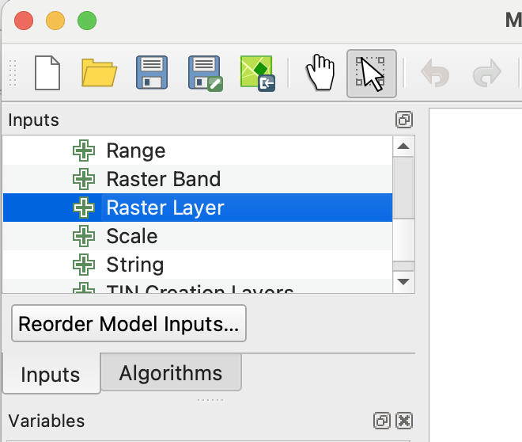
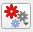

# __THis is not done yet, do not start__

# Gran Chaco Land-Use Change Detection

## Goal

Detect land-use change and deforestation in the Gran Chaco using dry-season satellite image composites.

## Study Area

- Use the [Gran Chaco AOI GeoJSON](assets/gran_chaco_aoi.geojson) as the area of interest.
- The AOI covers dry forest and agricultural clearing near the Cerro Chovoreca frontier in northern Alto Paraguay.
- Dry-season imagery composites are used to avoid cloud cover and reduce seasonal differences.

## Data 

You are being provided with data for an area in Paraguay's [Gran Chaco region](https://en.wikipedia.org/wiki/Gran_Chaco). The AOI includes dry forest and more recent agricultural clearing near the Cerro Chovoreca frontier. The dataset includes annual dry-season median composites made from June-August imagery.

Landsat 5, 7, 8 and 9 images were searched from June through August for the years 2000-2025 using Google Earth Engine. Images were filtered by date, area of interest, and sun angle. Cloud and cloud-shadow masking and surface reflectance scaling functions were then mapped over the image collections. Finally, the images for each year were reduced to annual dry-season median composite images. If you would like to see how this was done, see [this notebook](assets/sentinel_gran_chaco.html). (The notebook also builds Sentinel-2 composites, which are not used in this lab.)

The `landsat/` directory holds six composites, five years apart (@tbl-raster-files). The files are named `<sensor>_<year>_dry_season.tif`, where the sensor prefix tells you which satellite the imagery came from.

| File | Sensor | Year | Pixel size |
| --- | --- | --- | --- |
| `l57_2000_dry_season.tif` | Landsat 5 and 7 | 2000 | ~30 m |
| `l57_2005_dry_season.tif` | Landsat 5 and 7 | 2005 | ~30 m |
| `l57_2010_dry_season.tif` | Landsat 5 and 7 | 2010 | ~30 m |
| `l89_2015_dry_season.tif` | Landsat 8 and 9 | 2015 | ~30 m |
| `l89_2020_dry_season.tif` | Landsat 8 and 9 | 2020 | ~30 m |
| `l89_2025_dry_season.tif` | Landsat 8 and 9 | 2025 | ~30 m |

: Raster files in the `landsat/` directory. {#tbl-raster-files}

These years were picked from a full 2000–2025 series because they are evenly spaced and have few image artifacts. Some years in between have stripes from the failed scan-line corrector on Landsat 7, or come from extreme drought years that make change hard to detect.

All files cover the same area and share these properties:

- **Bands:** six bands, named `blue`, `green`, `red`, `nir`, `swir1` and `swir2`, in the order shown in @tbl-exported-bands.
- **Values:** surface reflectance, already scaled to 0–1. A value of 0.2 means the surface reflected about 20% of the incoming light in that band. Healthy vegetation has low red (~0.05) and high NIR (~0.2–0.3) values.
- **CRS:** EPSG:4326 (WGS 84), so coordinates and pixel sizes are in degrees, not meters. You will reproject to the project CRS before calculating areas.
- **Missing data:** pixels masked for cloud or cloud shadow are stored as NaN.

| Exported TIF band | Common name | Landsat 5/7 band | Landsat 8/9 band |
| --- | --- | --- | --- |
| 1 | Blue | SR_B1 | SR_B2 |
| 2 | Green | SR_B2 | SR_B3 |
| 3 | Red | SR_B3 | SR_B4 |
| 4 | Near infrared | SR_B4 | SR_B5 |
| 5 | Shortwave infrared 1 | SR_B5 | SR_B6 |
| 6 | Shortwave infrared 2 | SR_B7 | SR_B7 |

: Exported image band order and source sensor bands. {#tbl-exported-bands}

## Setup 

Download the project [here](). Extract the folder found within the zip to your `nr218` directory. The project folder contains a QGIS project file and six TIFs in a directory called `landsat/`.

Open the QGIS project. Set the project CRS to an appropriate UTM CRS.

## Change Detection Workflow
First inspect the data to get an idea what you are looking at.

1. Choose comparison years.
   - Select one older image and one newer image.
   - Suggested pair: 2000 (`l57_2000_dry_season.tif`) vs 2025 (`l89_2025_dry_season.tif`). Both are 30 m Landsat composites, so the pixels line up and you capture 25 years of change.

2. Inspect false-color composites.
   - Use NIR, red, green to highlight vegetation.
   - Use SWIR1, NIR, red to highlight bare soil, clearing, and dry vegetation.

Now that you have given it the old eyeball, you can start trying to quantify year to year change.

### Calculate vegetation or disturbance indices.

You will work with six Landsat composites, five years apart, from the `landsat/` folder: 2000, 2005, 2010, 2015, 2020 and 2025. For each one you will make two single-band rasters:

- **NDVI**, the classic "greenness" index.
- **SWIR1**, the shortwave infrared 1 reflectance (band 5) on its own.

You will use both to detect clearing and then compare how well each one works.

You will use QGIS Model Designer to build a model that calculates NDVI for each composite raster and saves the result to a file.

1. **Create the output folders.**
   Create an `ndvi` directory and a `swir1` directory next to the QGIS project file.

   ```
   gran_chaco_project/
   ├── gran_chaco.qgz
   ├── landsat/
   │   ├── l57_2000_dry_season.tif
   │   ├── ...
   │   └── l89_2025_dry_season.tif
   ├── ndvi/
   └── swir1/
   ```

2. **Open Model Designer and name the model.**
   - Open _Processing --> Model Designer..._
   - In the panel at the lower left, set the Model Name to "calc NDVI" and the model group to "calc index".

3. **Add the raster input.**
   - At the top of the left panel, open the _Inputs_ tab (see @fig-add-raster-layer).
   - Double click _Raster layer_.
   - In the dialogue, enter `input_image` as the description (this will serve a reference to the input, so the exact name will be important later), check the _mandatory_ box, then close the dialogue.

   {#fig-add-raster-layer .wrap-right style="--wrap-width:40%;" fig-alt="QGIS graphical modeler Inputs panel showing the Raster Layer option used to add a raster input."}

4. **Save the model.**
   Press the "save model in project" button ({width="35px" style="vertical-align:middle;"}). (If you want to use this model in another project, you can save it as a file with the _Save model as_ button.)

5. **Reproject the raster to the project CRS.**
   - Click the _Toolbox_ tab in the left panel and search for "Warp".
   - Click _Warp_ from _GDAL -> Raster Projections_.
   - Change the description to "Warp to project CRS".
   - Use `input_image` as the input layer and check the _Use project CRS_ box.
   - Change _Resampling method to use_ to bilinear, then close the dialogue.
   - Press the "save model in project" button.

6. **Add the Raster calculator and connect the bands.**
   Recall that the formula for NDVI is

   $$
   \frac{NIR - Red}{NIR + Red}
   $$

   and from @tbl-exported-bands you can see that NIR is band 4 and red is band 3 in the input image.

   - From the toolbox add _GDAL -> Raster miscellaneous -> Raster calculator_.
   - Add the description "calc NDVI".
   - Under _Input layer A_, click the _Model input_ button ({width="35px" style="vertical-align:middle;"}) and change it to _Algorithm Output_.
   - In the dropdown next to the _Algorithm output_ button ({width="35px" style="vertical-align:middle;"}), select _"Reprojected" from algorithm "Warp to project CRS"_.
   - Under _Number of raster band for A_, enter 4 (NIR).
   - Repeat for _Input layer B_, but use band 3 (red).

7. **Enter the NDVI formula.**
   In _Calculation in gdalnumeric syntax using..._ enter `(A - B) / (A + B)`.

8. **Set the output filename.**
   We want to run this tool as a batch process and save the results to file, so the output name is built from the input name.
   - Change the button under _Calculated_ to _Pre-calculated Value_.
   - Enter this QGIS expression:

   ```
   @project_folder || '/ndvi/NDVI_' || base_file_name(decode_uri(@input_image, 'path')) || '.tif'
   ```

   For more on this see the Expression breakdown tip box.

   ::: {.callout-tip}
   ## Expression breakdown

   - `@project_folder` is a QGIS variable for the folder containing the current `.qgz` project
   - `||` is a string concatenation, meaning “join these text pieces”
   - `'/ndvi/NDVI_'` is literal text: the output folder plus the prefix for the new filename
   - `@input_image` is the model input variable; __this must match the input name__ that you specified when you added the input to the model
   - `decode_uri(@input_image, 'path')` extracts the filesystem path from the input raster/layer URI
   - `base_file_name(...)` gets the file stem without folder or extension
   - `'.tif'` is the file extension to add
   :::

9. **Make a model for SWIR1.**
   SWIR1 is not an index. You just need band 5 by itself, warped to the project CRS like the NDVI. Build a second model the same way (steps 2–8), with these changes:
   - Model Name: "calc SWIR1" (same group, "calc index").
   - Raster calculator description: "extract SWIR1".
   - _Input layer A_: the Warp output, band **5** (SWIR1). Leave _Input layer B_ empty.
   - Formula: `A`
   - Output expression: change `'/ndvi/NDVI_'` to `'/swir1/SWIR1_'`.

10. **Run each model as a batch process.**
    - Save the model and close Model Designer.
    - In the Processing Toolbox, open _Project models -> calc index_, right-click "calc NDVI" and choose _Execute as Batch Process..._
    - At the top of the `input_image` column, click _Autofill..._ and choose _Select from Available Layers..._ Tick the six composites from the `landsat/` folder and click OK. You get one row per raster. (The rasters must be loaded in the project to show up in this list.)
    - Click _Run_. The output filenames come from the expression in step 8, so there is nothing to fill in for the outputs.
    - Repeat for "calc SWIR1".
    - When both are done, add the new rasters in `ndvi/` and `swir1/` to the project (for example by dragging them in from the Browser panel). The next step needs them loaded.

<!-- end of index steps list; keeps the workflow list below separate -->

Before you go on, put `SWIR1_l57_2000_dry_season` and `SWIR1_l89_2025_dry_season` side by side. Style both with the same min/max (about 0.1 to 0.35). Intact forest is **dark** in SWIR1 (roughly 0.15–0.19). Cleared fields are **bright** (above about 0.21). Now do the same with the two NDVI layers. Which one shows the cleared fields more clearly?

### Calculate change between dates

Next you will subtract each date's raster from the one five years later. The result shows where the value went up or down over those five years:

$$
\Delta = value_{later} - value_{earlier}
$$

- **dNDVI**: a large negative value may mean vegetation loss.
- **dSWIR1**: a large **positive** value may mean clearing, because cleared ground is brighter in SWIR1 than forest. Note the sign is the opposite of dNDVI.
- Values near 0 mean little or no change.

This time you do not need a model. There is only one step, so you will run the GDAL Raster calculator directly as a batch process. The NDVI and SWIR1 rasters are already in the project CRS, so no Warp step is needed either.

1. **Create the output folders.**
   Create a `change` directory next to the QGIS project file, with a folder inside it for each layer type.

   ```
   gran_chaco_project/
   ├── gran_chaco.qgz
   ├── landsat/
   ├── ndvi/
   ├── swir1/
   └── change/
       ├── dNDVI/
       └── dSWIR1/
   ```

2. **Open the Raster calculator as a batch process.**
   In the Processing Toolbox, find _GDAL -> Raster miscellaneous -> Raster calculator_, right-click it and choose _Execute as Batch Process..._ (Make sure you use the GDAL one. There is also a QGIS _Raster calculator_ under _Raster analysis_, which works differently.)

3. **Fill in the layer pairs.**
   Each row subtracts one pair of rasters: the later date goes in _Input layer A_ and the date five years before it goes in _Input layer B_. Start with SWIR1:

   - At the top of the _Input layer A_ column, click _Autofill... -> Select from Available Layers..._ and tick the `SWIR1` layers for 2005, 2010, 2015, 2020 and 2025 (every date except the oldest). This makes 5 rows.
   - At the top of the _Input layer B_ column, do the same, but tick 2000, 2005, 2010, 2015 and 2020 (every date except the newest).
   - Leave _Number of raster band for A_ and _Number of raster band for B_ at 1. These rasters only have one band.

   ::: {.callout-warning}
   ## Check your pairs before you run

   Autofill fills the rows in the order the layers appear in the list, which may not be date order. Before you click _Run_, read down both columns and make sure every _Input layer A_ is exactly five years after the _Input layer B_ in the same row (2005 and 2000, 2010 and 2005, and so on). If a row is off, use the dropdown in that cell to pick the right layer.
   :::

   ::: {.callout-note}
   ## Mixing Landsat 5/7 and Landsat 8/9

   The 2010→2015 pair compares a Landsat 5/7 composite with a Landsat 8/9 composite. That is fine here: all six composites were exported on exactly the same grid, and SWIR1 values for unchanged forest are very similar for both sensor groups.
   :::

4. **Enter the subtraction.**
   In the first row of the _Calculation in gdalnumeric syntax..._ column enter `A - B`, then click _Autofill... -> Fill Down_ at the top of the column to copy it to every row. The order matters: later minus earlier.

5. **Set the output filenames.**
   - In the first row of the _Calculated_ column, click the _..._ button and choose _Save to File..._
   - Go to `change/dSWIR1/`, enter `d.tif` as the filename and click _Save_.
   - In the _Autofill settings_ dialogue, choose _Fill with parameter values_ and pick _Input layer A_ as the parameter, then click OK.

   Each output is named `d` plus the name of its later layer. For example, `SWIR1_l89_2025_dry_season` minus `SWIR1_l89_2020_dry_season` is saved as `change/dSWIR1/dSWIR1_l89_2025_dry_season.tif`, the change from 2020 to 2025. Check that the output column looks like this before you run.

6. **Run, then repeat for NDVI.**
   - Click _Run_.
   - Repeat steps 2–5 with the `NDVI` layers, saving into `change/dNDVI/`.
   - Add all ten change rasters to the project.

<!-- end of change steps list; keeps the workflow list below separate -->

### Compare dNDVI and dSWIR1

Style the change rasters so they are easy to compare:

- **dNDVI:** singleband pseudocolor, `RdYlGn` color ramp, min −0.4, max 0.4. Red = NDVI went down, green = NDVI went up.
- **dSWIR1:** singleband pseudocolor, `RdYlGn` color ramp **inverted**, min −0.1, max 0.1. Red = SWIR1 went up (possible clearing), green = SWIR1 went down.

Now look closely at two periods, **2010→2015** and **2015→2020**, and answer these questions:

1. In `dNDVI_l89_2020_dry_season` (2015→2020), what color is the large area of forest that was never cleared? If you used dNDVI alone, what would you conclude happened to that forest?
2. In `dNDVI_l89_2015_dry_season` (2010→2015), find a field that was cleared during that period (compare the 2010 and 2015 composites). Did NDVI go up or down there? Why might clearing a forest make NDVI go *up*?
3. Look at the same two periods in dSWIR1. Does the uncleared forest stay near 0? Do the newly cleared fields stand out?

::: {.callout-note collapse="true"}
## Why dry and wet years confuse NDVI (open after answering)

The Gran Chaco has a strong dry season, and how dry it gets changes a lot from year to year. Judging from the imagery, the dry seasons of 2015 and 2025 were relatively wet and green, while 2010 and 2020 were much drier.

- In a **dry year** the forest drops some leaves and gets less green, so its NDVI falls even though nothing was cut. Compare 2015 (wet) with 2020 (dry) and the whole forest looks like it lost vegetation.
- In a **wet year** the planted pastures turn bright green, often greener than the forest itself. So a field cleared between 2010 (dry) and 2015 (wet) can have a *higher* NDVI afterward than the forest it replaced.

NDVI measures greenness, and greenness here depends mostly on rainfall. SWIR1 responds to the structure of the surface. A forest canopy is rough and full of shadow and moist leaves, so it stays dark in SWIR1 whether the year is wet or dry. Pasture and bare soil are flat and bright in SWIR1, whether the grass is green or dead. That is why the forest/cleared difference in SWIR1 holds up across wet and dry years.
:::

### Map clearing

A pixel was **cleared** during a five-year period if both of these are true:

- **It was forest at the start:** SWIR1 in the earlier year is below 0.20.
- **It got brighter:** dSWIR1 is greater than 0.05.

The first condition matters. Without it, fields that were already cleared and just got drier between two years would also be counted as new clearing.

1. **Create the output folder.** Create `change/cleared/`.

2. **Open the GDAL Raster calculator as a batch process** (same as before).

3. **Fill in the inputs.**
   - _Input layer A_: Autofill with the five `dSWIR1` layers.
   - _Input layer B_: Autofill with the `SWIR1` layers for the **earlier** year of each pair: 2000, 2005, 2010, 2015 and 2020.
   - Check the pairs: `dSWIR1_l57_2005_dry_season` (2000→2005) goes with `SWIR1_l57_2000_dry_season`, and so on.

4. **Enter the rule.**
   In the first calculation cell enter the expression below, then use _Fill Down_:

   ```
   (B < 0.20) * (A > 0.05)
   ```

   Each comparison gives 1 where it is true and 0 where it is false. Multiplying them gives 1 only where **both** are true, so it works as an AND. The output is 1 for cleared and 0 for everything else.

5. **Set the output filenames.** Save the first row as `change/cleared/cleared_.tif`, then _Fill with parameter values_ from _Input layer A_. The 2020→2025 result becomes `cleared_dSWIR1_l89_2025_dry_season.tif`.

6. **Run, add the results, and check them.**
   Style each cleared layer so 1 is a bright color and 0 is transparent, and put it over the later composite in false color (SWIR1, NIR, red). Do the red patches line up with new fields? Pan around some intact forest: are there false alarms?

   The 0.20 and 0.05 thresholds were chosen by checking known forest and known fields in these images. If you find areas where they do not work well, try adjusting them and note what changed.

### Clean the map

The cleared maps contain some single pixels and tiny patches along field edges and roads. Remove them with a sieve:

1. Open _GDAL -> Raster analysis -> Sieve_ as a batch process.
2. Autofill the input column with the five `cleared_` layers.
3. Set _Threshold_ to 11 and leave _Use 8-connectedness_ unchecked. Each pixel is about 29 m × 29 m ≈ 0.085 ha, so 11 pixels is about 1 ha. Any cleared patch smaller than that is removed.
4. Save the outputs to `change/cleared/` with the prefix `sieved_` (save the first row as `sieved_.tif` and _Fill with parameter values_ from the input layer).

### Calculate cleared area

1. Open _Raster analysis -> Raster layer unique values report_ as a batch process and add the five `sieved_` layers.
2. For each report, find the row where the value is 1. It gives the pixel count and the area in m².
3. Convert to hectares (divide by 10,000) and make a table of cleared area for each five-year period.

Which period had the most clearing?

**Optional:** Polygonize one of the sieved rasters (_GDAL -> Raster conversion -> Polygonize_) and look at the size and shape of the cleared patches.

### Validate visually

- Compare each cleared map with the before and after composites.
- Check several cleared fields and several intact forest patches.
- Note any confusion: cropland cycles, bare soil, burned areas, or the rocky, sparsely vegetated hills of Cerro Chovoreca in the north.

## Outputs

- Before and after dry-season composites.
- False-color maps showing land-cover patterns.
- Index difference raster.
- Classified change raster or vector layer.
- Summary table of changed area.
- Short interpretation of where and how land use changed.

## Notes

- Use the same months for each year to reduce seasonal bias.
- Median composites help, but they do not remove all phenology or crop-cycle differences.
- Landsat gives a 25-year record (2000–2025) at ~30 m resolution. Sentinel-2 has finer detail (~10 m) but its record only starts in the late 2010s, so it can't show the early clearing.
