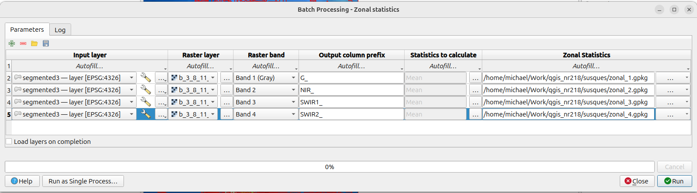
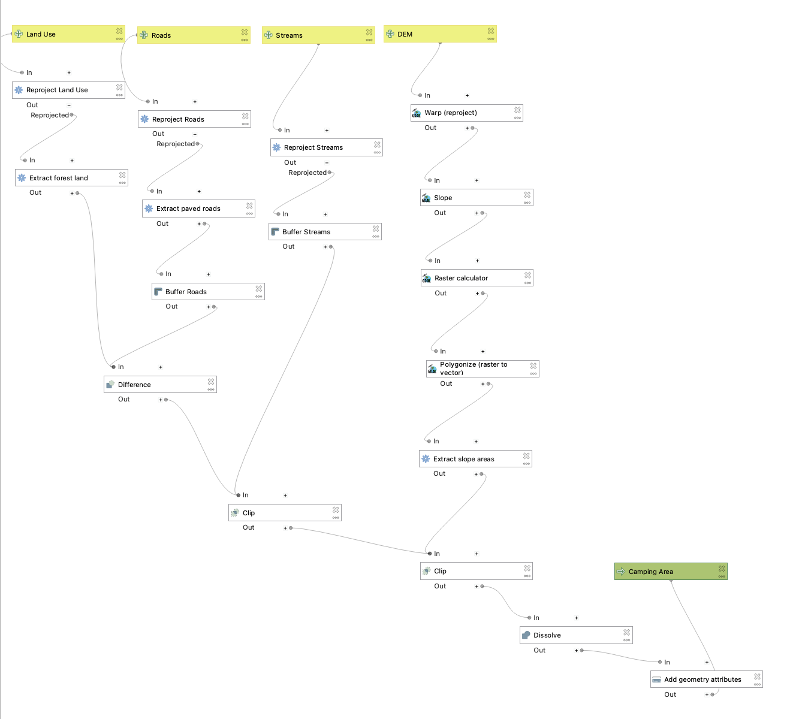

# Workflows: Batch Processing and Model Designer

## Data
Download for examples:

- [ca_quakes_2015_2024.zip](https://raw.githubusercontent.com/kulpojke/nr218/main/assets/ca_quakes_2015_2024.zip) (one CSV of earthquakes per year)
- [cal_counties.geojson](https://raw.githubusercontent.com/kulpojke/nr218/main/assets/cal_counties.geojson)

## Why automate? {style="font-size:0.7em"}

- GIS work is full of repetition: the same steps for every year, every tile, every county, every band
- Doing it by hand is slow, and every click is a chance to make a mistake
- An automated workflow is **reproducible**: you (or someone else) can run it again and get the same result
- The workflow is also **documentation**: it records exactly what you did
- You can change one thing (a threshold, an input, a CRS), rerun everything

## Three ways to automate work in QGIS {style="font-size:0.6em"}

| | What it repeats | Example |
| --- | --- | --- |
| **Batch processing** | One tool, many runs | Buffer 10 layers at once |
| **Model Designer** | A chain of tools, packaged as one new tool | CSV → points → filter → count per county |
| **Python (PyQGIS)** | Anything | Not today |

<br>

[They combine: **a model can be run as a batch**. That is where the real power is.]{.fragment}

## You already have a record of your workflow {style="font-size:0.7em"}

- _Processing → History..._ lists every Processing tool you have run, with all of its parameters
- Double-click an entry to open the tool again with the same settings
- Right-click to copy it as a Python command or a `qgis_process` command (more on that at the end)

## Today's data: California earthquakes {style="font-size:0.6em"}

:::: {.columns}
::: {.column width="55%"}
- From the USGS earthquake catalog (ComCat)
- Every magnitude 2.5+ earthquake, 2015–2024
- **One CSV per year**: `ca_quakes_2015.csv` … `ca_quakes_2024.csv`
- Useful columns: `time`, `latitude`, `longitude`, `depth`, `mag`, `place`
- The search area is a rectangle, so it includes parts of Nevada, Mexico and the ocean
- Plus `cal_counties.geojson`, which you have used before
:::

::: {.column width="45%"}
| Year | M2.5+ events |
| --- | --- |
| 2015 | 1087 |
| 2016 | 975 |
| 2017 | 854 |
| 2018 | 715 |
| 2019 | **3641** |
| 2020 | **2627** |
| 2021 | 1533 |
| 2022 | 958 |
| 2023 | 901 |
| 2024 | 1049 |
:::
::::

[What happened in 2019? We'll use batch processing and a model to find out where.]{.fragment}

## Part 1: Batch processing

## The batch window {style="font-size:0.6em"}

- In the Processing Toolbox, right-click a tool → _Execute as Batch Process..._
- **Each row is one run of the tool. Each column is one of the tool's parameters.**
- Add or remove rows with the ➕ / ➖ buttons
- Save the whole table (📁 / 💾 buttons) and load it again later
- Tick _Load layers on completion_ if you want to see the results right away

{fig-alt="QGIS batch processing window for Zonal statistics with four rows, each using a different raster band" width="100%"}

## Autofill: filling the table quickly {style="font-size:0.6em"}

The _Autofill..._ menu at the top of each column:

- **Select Files... / Add All Files from a Directory...**: one row per file
- **Select from Available Layers...**: one row per layer already loaded in the project
- **Fill Down**: copy the first row's value into every row
- **Calculate by Expression...**: build each row's value with a QGIS expression

For the **output** column, pick a file name for the first row with _..._ → _Save to File..._ and QGIS offers to autofill the rest:

- **Fill with numbers**: `out1.gpkg`, `out2.gpkg`, ...
- **Fill with parameter values**: add the name of an input to each file name, e.g. `pts_ca_quakes_2019.gpkg`

## Batch example: ten CSVs → ten point layers {style="font-size:0.6em"}

Tool: _Vector creation → Create points layer from table_

1. **Input layer:** _Autofill → Select Files..._ → pick all ten CSVs (10 rows)
2. **X field:** `longitude` → _Fill Down_
3. **Y field:** `latitude` → _Fill Down_
4. **Target CRS:** EPSG:4326 → _Fill Down_
5. **Points from table:** first row `quakes/pts_.gpkg` → _Fill with parameter values_ → _Input layer_
6. _Run_

::: {.callout-warning}
X is **longitude**, Y is **latitude**. Swap them and your earthquakes end up in Antarctica.
:::

## A batch doesn't have to use many files {style="font-size:0.7em"}

Rows can change **any** parameter, not just the input:

- One layer, several buffer distances: 1 km, 5 km, 10 km
- One DEM, hillshades from several sun angles
- One raster, focal filters with 3×3, 5×5 and 9×9 windows
- One set of polygons, zonal statistics for each band (the screenshot two slides back: same layers, bands 1–4)

## Part 2: Model Designer

## What is a model? {style="font-size:0.7em"}

- A **flowchart that runs**: boxes are tools, lines carry data from one tool to the next
- Inputs (yellow) go in at the top, outputs (green) come out at the bottom
- Once saved, it shows up in the Processing Toolbox like any other tool
- So you can run it once, **or run it as a batch**

## What a model can look like {.smaller}

{fig-alt="A large QGIS model with four inputs (land use, roads, streams, DEM) feeding reproject, extract, buffer, slope, clip and dissolve steps, ending in a Camping Area output" style="max-height: 60vh; object-fit: contain;"}

Four inputs, about fifteen steps, one output. Today's will be much smaller.

## The Model Designer window {style="font-size:0.6em"}

_Processing → Model Designer..._

- **Inputs tab:** the parameters your model will ask for (Vector layer, Raster layer, Number, Field, File/Folder, CRS, ...)
- **Algorithms tab:** every Processing tool; drag one onto the canvas
- **Canvas:** where the flowchart is built
- **Model properties:** the model's name and group (where it appears in the Toolbox)
- **Toolbar:** run the model (▶), save in the project, save to a `.model3` file, export as an image or a Python script

**Save often.** Model Designer will not save your work for you.

## Where does each value come from? {style="font-size:0.6em"}

When you add a tool to a model, each parameter has a button that sets **where its value comes from**:

| Source | Meaning | Example |
| --- | --- | --- |
| **Value** | Typed in, the same every time | Target CRS = EPSG:4326 |
| **Model Input** | Asked for when the model runs | the CSV file |
| **Algorithm Output** | The result of an earlier step | the points from step 1 |
| **Pre-calculated Value** | An expression worked out when the model runs | an output file name |

**Algorithm Output** is what chains tools together. This is the part people find most confusing, so take it slowly.

## Outputs: final vs. intermediate {style="font-size:0.7em"}

- Every tool in a model produces output, but most of it you don't need to keep
- **Leave an output's name blank**: it is temporary and thrown away when the model finishes
- **Give an output a name**: it becomes a **model output**, and you choose where it is saved when you run the model
- To make the output name come from the input name (handy in a batch), use a **Pre-calculated Value** expression, like in the Gran Chaco lab:

```
@project_folder || '/out/counts_' || base_file_name(decode_uri(@quake_csv, 'path')) || '.gpkg'
```

## Example model: earthquakes per county {style="font-size:0.7em"}

Three inputs, three steps, one output:

::: {style="font-size:1.3em"}
```
quake_csv (input)
    │
    ▼
[1] Create points layer from table
    │
    ▼
[2] Extract by expression    ◄── min_mag (input)
    │
    ▼
[3] Count points in polygon  ◄── counties (input)
    │
    ▼
quake_counts (output)
```
:::

How many earthquakes of at least `min_mag` happened in each county, in the year given by `quake_csv`?

## The model, step by step {style="font-size:0.6em"}

| Step | Tool | Settings |
| -- | ------ | ------------ |
| Inputs | | `quake_csv` (Vector layer, Geometryless), `counties` (Vector layer, Polygon), `min_mag` (Number, default 3) |
| 1 | Create points layer from table | X = `longitude`, Y = `latitude`, CRS = EPSG:4326 |
| 2 | Extract by expression | `"mag" >= @min_mag` (model inputs become `@variables`) |
| 3 | Count points in polygon | polygons = `counties`, points = step 2, field name `n_quakes` |

## Build it, then test it {style="font-size:0.7em"}

1. Add the three inputs
2. Add the three tools and connect them with **Algorithm Output**
3. Name the last output `quake_counts`
4. Save the model in the project
5. **Run it once** (▶) on a single year, e.g. 2019
6. Check the result: open the attribute table, sort by `n_quakes`

**Always test on one input before you run a batch.** If it's wrong once, it will be wrong ten times.

## Run the model as a batch {style="font-size:0.7em"}

Processing Toolbox → _Models_ (or _Project models_) → right-click your model → _Execute as Batch Process..._

- `quake_csv`: _Autofill → Select Files..._ → all ten CSVs
- `counties`: pick `cal_counties` → _Fill Down_
- `min_mag`: `3` → _Fill Down_
- `quake_counts`: first row `counts_.gpkg` → _Fill with parameter values_ → `quake_csv`
- _Run_. That's ten years × three steps = 30 tool runs from one click.

## What did we find? {style="font-size:0.6em"}

| Year | M3+ in search area | M3+ inside CA counties | Top counties |
| --- | --- | --- | --- |
| 2018 | 176 | 149 | Riverside, San Benito, San Bernardino |
| 2019 | 1385 | 1309 | **Inyo (592), San Bernardino (567)** |
| 2020 | 898 | **380** | Imperial, Inyo, Mono |
| 2022 | 270 | 199 | **Humboldt** |

::: {.fragment}
- **2019:** the Ridgecrest sequence (M6.4 and M7.1, July 2019) and thousands of aftershocks
- **2020:** most of the M3+ quakes were **outside** California: the M6.5 Monte Cristo Range earthquake in Nevada (May 2020). Counting only inside the counties changed the answer.
- **2022:** the M6.4 Ferndale earthquake (December 2022)
:::

## Gotchas {style="font-size:0.6em"}

- **Test on one input first**, then batch
- **X = longitude, Y = latitude**
- **CSVs opened from a file are all text.** `"mag" >= 3` still works, but use `to_real("mag")` for math or graduated symbols
- **_Select from Available Layers_ only lists loaded layers.** Use _Select Files..._ for files on disk
- **Check that your rows line up** (e.g. year 2005 with year 2000) before clicking _Run_
- **Same output name = overwritten file.** Build names from the input name
- **Save in project vs. save as file:** a `.model3` file can be reused in other projects and shared

## From a model to code {style="font-size:0.6em"}

Everything you ran is just a command. _Processing → History_ → right-click → copy as `qgis_process` command:

```bash
qgis_process run native:createpointslayerfromtable -- \
    INPUT=ca_quakes_2019.csv XFIELD=longitude YFIELD=latitude \
    TARGET_CRS=EPSG:4326 OUTPUT=pts_2019.gpkg

qgis_process run native:extractbyexpression -- \
    INPUT=pts_2019.gpkg EXPRESSION='"mag" >= 3' OUTPUT=m3_2019.gpkg

qgis_process run native:countpointsinpolygon -- \
    POLYGONS=cal_counties.geojson POINTS=m3_2019.gpkg \
    FIELD=n_quakes OUTPUT=counts_2019.gpkg
```

Model Designer can also export a model as a Python script. Models and batches are a stepping stone to scripting.

## Up next: the Gran Chaco lab {style="font-size:0.7em"}

You'll use both tools on satellite imagery:

- A **model** that reprojects each Landsat composite and writes NDVI and SWIR1 to their own folders
- **Batch** runs of that model over six years, then batch raster calculations to find where forest was cleared
